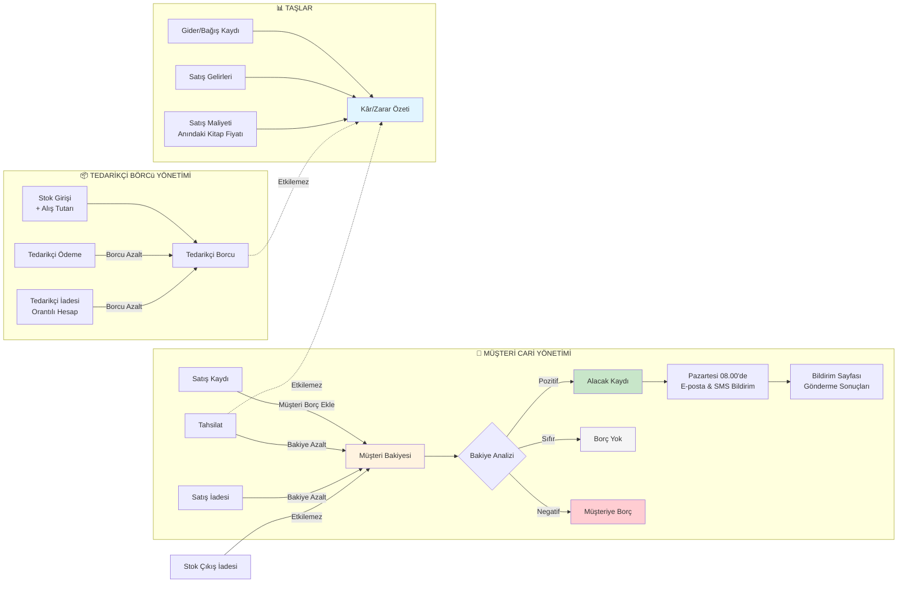

# Finansal Akış Diyagramı

Bu diyagram müşteri alacağı, tahsilat ve finansal raporlama sürecini göstermektedir.



## Müşteri Cari Yönetimi

### Bakiye Değişimleri

| İşlem | Etki | Açıklama |
|-------|------|---------|
| **Satış** | ↑ Artış | Müşteri borç ekle |
| **Tahsilat** | ↓ Azalış | Nakit/çek tahsilat |
| **Satış İadesi** | ↓ Azalış | Ürün iade, borç azal |
| **Stok Çıkış İadesi** | — | Müşteri hisselendirmeyen işlem |

### Alacak Takibi

- **Haftalık Bildirim**: Pazartesi 08:00'de bakiyesi pozitif olan müşterilere
- **İletişim Kanalları**: E-posta (PHP mail) + SMS (Twilio)
- **Gönderim Durumu**: Bildirimler sayfasında listelenir
- **Yeniden Deneme**: Başarısız gönderimler sonraki çalıştırmada tekrar denenir

## Tedarikçi Borcu Yönetimi

### Ödeme Takibi

1. **Stok Girişi**: Alış tutarı ve vade tarihi kaydedilir
2. **Tedarikçi Ödemesi**: Ödenmiş tutar kaydedilir
3. **Tedarikçi İadesi**: Orantılı hesap; formül = İade Tutarı × (İade Miktarı / Toplam Miktarı)
4. **Alacak Durumu**: Ödenmiş tutarı aşan iade, tedarikçiden alacak olarak gösterilir

## Kâr/Zarar Hesabı

```
Kâr/Zarar = Net Satış - Satış Maliyeti - Gider - Bağış

Burada:
  - Net Satış: Tüm satış tutarları toplamı
  - Satış Maliyeti: Satış yapılan anındaki kitap birim fiyatı × Satılan Adet
  - Gider: Kaydedilen tüm giderler
  - Bağış: Kaydedilen tüm bağışlar

ETKİSİZ İŞLEMLER:
  - Tahsilat: Bakiyeyi değiştirir, kâr/zararı etkilemez
  - Tedarikçi Borcu: Ödeme zamanı değiştirmez
  - Alınan Borç: Anapara ödemesi kâr/zararı etkilemez
```

## Raporlama

### Müşteri Ekstresi
- Tarih aralığına göre satış, tahsilat ve iade işlemlerini gösterir
- İşlem detayı, tarih, tutar bilgilerini içerir

### Vade Raporu
- Vadesi geçmiş satışlar listelenmiş
- Müşteri bakiyesi ile eşleşmeyebilir (tahsilat FIFO yöntemiyle yapılır)

### Stok Raporu
- Güncel stok, kritikal stok seviyeleri
- Satış potansiyeli yüksek ürünler

### Cari Raporu
- Müşteri bakiyeleri özeti
- Alacak-borç dengesi
