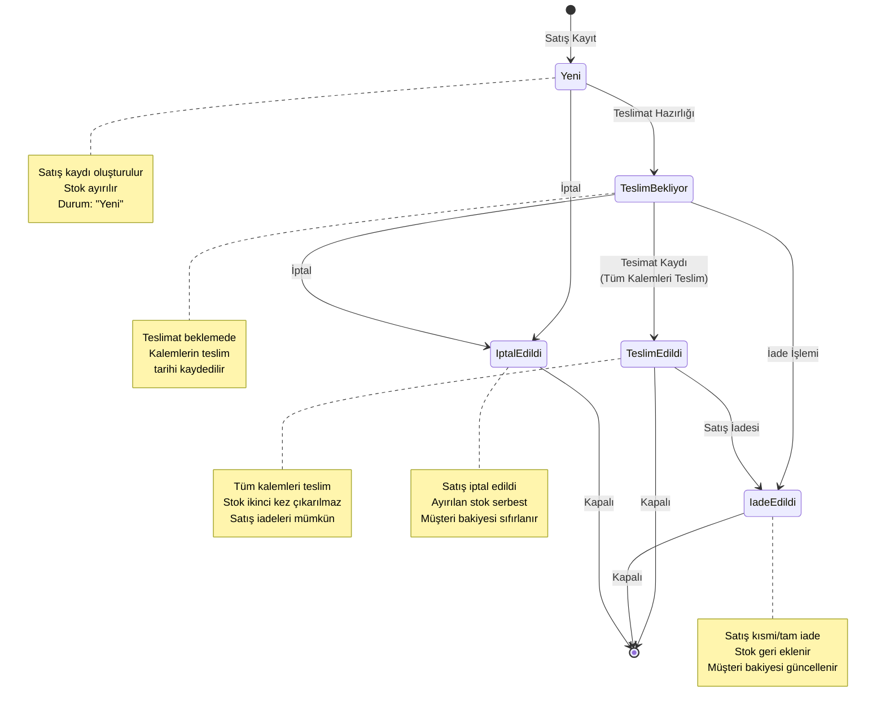

# Satış Akış Diyagramı

Bu diyagram satış kayıt, teslimat ve tamamlanma sürecini göstermektedir.

## Durum Açıklamaları

| Durum | Açıklama | İşlem |
|-------|----------|-------|
| **Yeni** | Yeni satış kaydı oluşturuldu | Satış Kayıt formundan giriş |
| **Teslimat Bekliyor** | Teslimatın hazırlanması beklenmekte | Satış İncele → Teslimat Hazırla |
| **Teslim Edildi** | Tüm kalemleri teslim edildi | Satış İncele → Teslimatı Kaydet |
| **İade Edildi** | Satış kısmi veya tamamen iade edildi | Satış İade işlemi |
| **İptal Edildi** | Satış iptal edildi | Satış İptal işlemi |

## Önemli Notlar

- **Otomatik Geçiş**: Teslimat sırasında tüm kalemleri teslim ederseniz durum otomatik olarak "Teslim Edildi"ye değişir
- **Kısmi Teslimat**: Teslimat formunda kitap ve adet seçimi olmaz; tüm kalemlerin teslim tarihi kaydedilir
- **Stok Yönetimi**: 
  - Satış kaydı oluşturulduğunda → Stok ilk kez düşer
  - Teslimat kaydı oluşturulduğunda → Stok ikinci kez düşülmez
  - İade işleminde → Stok geri eklenir
- **Müşteri Bakiyesi**: Satış oluşturulduğunda müşteriye borç eklenir, iade/tahsilat sonrası güncellenir
