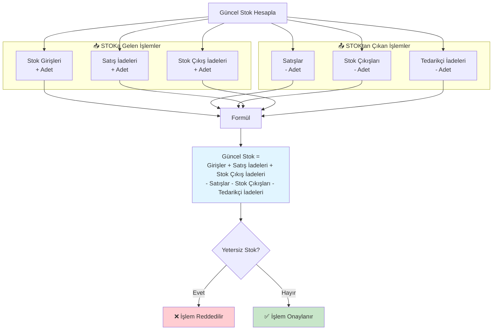

# Stok Akış Diyagramı

Bu diyagram stok girişi, satış ve çıkış işlemlerinin stok üzerindeki etkisini göstermektedir.

## Stok Hareketi Detayları

### Stoktan Çıkan İşlemler (-)

| İşlem | Açıklama | Bağlantı |
|-------|----------|---------|
| **Satış** | Satış kaydı yapıldığında stok anında düşer | Satış Kayıt |
| **Stok Çıkışı** | Stok hareket, kırılmış ürün, atık vs. | Stok → Çıkış |
| **Tedarikçi İadesi** | Tedarikçiye dönen ürünler | Finans → Tedarikçi İadeleri |

### Stoka Gelen İşlemler (+)

| İşlem | Açıklama | Bağlantı |
|-------|----------|---------|
| **Stok Girişi** | Yeni tedarikçi satınalması | Stok → Giriş |
| **Satış İadesi** | Müşteri tarafından iade edilen ürünler | Satış → İade |
| **Stok Çıkış İadesi** | Hatalı stok çıkışının düzeltilmesi | Stok → Çıkış İadesi |

## Önemli Kurallar

- **Yetersiz Stok**: Stok bitmişse satış ve çıkış işlemleri reddedilir
- **Teslimat Kaydı**: Satış teslim edilirken stok ikinci kez düşülmez (sadece satış kaydında düşer)
- **Kısmi Teslimat**: Satış bölme ve kısmi iade desteklenir; her işlem stoku günceller
- **FIFO Yöntemi**: Tahsilat işleminde eski alacaklar önce mahsup edilir

## Finansal Etki

- **Kâr/Zarar Hesabı**: Net Satış - Satış Anındaki Kitap Maliyeti - Gider - Bağış
- **Alacak Takibi**: Müşteri bakiyesi satış ile artar, tahsilat ve iade ile azalır
- **Tedarikçi Borcu**: Stok girişiyle artış, ödeme ve iade ile azalış
